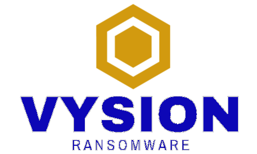

<p align="center">

</p>

---
## Configuration

Before launching the containers, make sure to create the environment files **.env** under the corresponding folders:

* *vysion_ransomware_api/docker/*
* *vysion_ransomware_monitor/docker/*
* *vysion_ransomware_webapp/docker/*

A template file "**.env_template**" and a **README.md** file are provided in each case. Carefully read them to correctly configure the environment files. 

## Launching the containers

In order to execute the containers, run the file **run.sh**. This script has several options and parameters:

```cmd
bash run.sh [OPTIONS] [CONTAINERS]
```

* [OPTIONS] : 
    * *-u, --update* : removes all containers and images, saving the volumes and thus the data. 
    * *-c, --clean* : removes all containers, images, volumes and networks.
    * *-r, --rebuild* : rebuilds the container's images.
* [CONTAINERS] :
    * *all* : launches all the containers
    * *monitor* : launches **tor** and **monitor**.
    * *databases* : launches **elasticsearch**, **kibana** and **minio**.
    * *api* : launches **api** container
    * *webapp* : launches **postgres** and **dashboard**

After deploying Elastic database, if no index or dashboard is found, execute the **vysion_ransomware/scripts/configElasticKibana.sh** script from inside that folder to create the correct mapping for the elastic index and kibana dashboard. The containers services are accessible from the following URL addresses:

* **elasticsearch** : *localhost:9200*
* **kibana** : *localhost:5601*
* **minio** : *localhost:9001*
* **airflow** : *localhost:8080*
* **api** : *localhost:8000*
* **webapp** : *localhost:3000*
